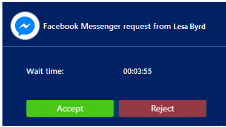
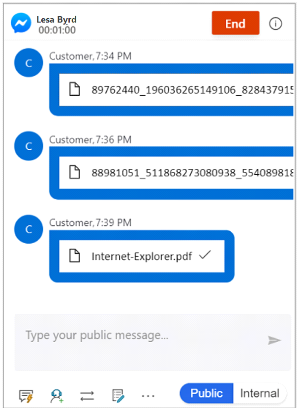
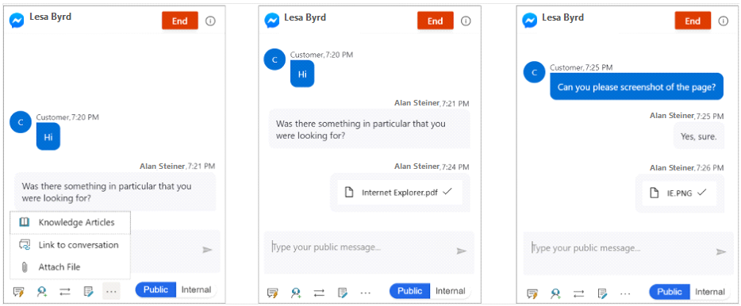

## Prerequisite

Make sure your administrator has [configured a Facebook channel](/dynamics365/customer-service/administer/configure-facebook-channel).

### Incoming Facebook notification

You receive a notification when a customer requests a Facebook conversation. When you accept the Facebook request, a session starts and the communication panel in which you can exchange messages with the customer is displayed.

> [!div class=mx-imgBorder]
> 

[!INCLUDE[cc-channels-representative-experience](cc-channels-representative-experience.md)]

## Privacy notice

Customers are solely responsible for using Dynamics 365, this feature, and any associated feature or service in compliance with all applicable laws, such as laws relating to monitoring, recording, and storing communications with their end users. This includes adequately notifying end users that their communications with agents may be monitored, recorded, or stored and, as required by applicable laws, obtaining consent from end users before using the feature with them. Customers are also encouraged to have a mechanism in place to inform their agents that their communications with end users may be monitored, recorded, or stored.

## Send and receive file attachments

You can send file attachments to customers during a Facebook channel conversation. Before you send a file, make sure you understand the file size limit and file extension types set by your administrator.

The communication panel displays the files that you receive from a customer. To view the file, select it and save it to your computer. The file name shown on an image that the customer sends might not reflect the actual file name, but a randomly generated number.

> [!div class=mx-imgBorder]
> 

If a customer sends an unsupported file extension type, the following error message appears in the communication panel: **Error: Customer sent an unsupported message type**.

### Send a file

To send a file, follow these steps:

1. Select the ellipsis (...) in the communication panel.

1. Select **Attach file**. A window is displayed.

1. Browse and select the file to send it.

    > [!div class=mx-imgBorder]
    > 
