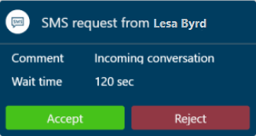

## Prerequisite

Make sure your administrator [configured a Twilio SMS channel](/dynamics365/customer-service/administer/configure-sms-channel-twilio).

### Incoming chat notifications

You receive a notification when a customer requests a conversation through Twilio. You can accept the chat request, after which a session starts and the communication panel opens, where you can exchange messages with the customer.

> [!div class=mx-imgBorder]
> 

[!INCLUDE[cc-channels-representative-experience](cc-channels-representative-experience.md)]
