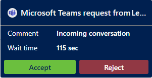

## Prerequisite

Make sure that your administrator has [configured a Teams channel](/dynamics365/customer-service/administer/configure-microsoft-teams).

## Incoming Teams chat notification

You receive a notification when a customer requests a conversation through Teams. When you accept the Teams chat request, a session starts, and the communication panel opens, in which you can exchange messages with the customer.

> [!div class=mx-imgBorder]
> 

[!INCLUDE[cc-channels-representative-experience](cc-channels-representative-experience.md)]
