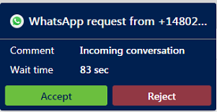
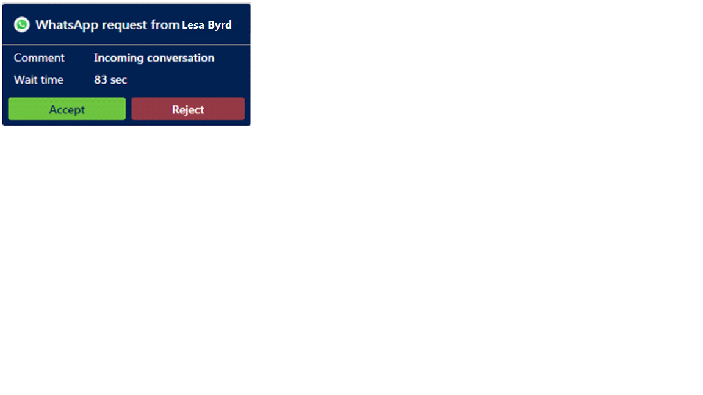

## Prerequisite

Make sure your administrator has [configured a WhatsApp channel through Twilio](/dynamics365/customer-service/administer/configure-whatsapp-channel).

### Incoming WhatsApp notification

You receive a notification when a customer requests a WhatsApp conversation. Accepting the WhatsApp request starts a session and opens the communication panel, in which you can exchange messages with the customer.

**Unauthenticated customer incoming notification**

> [!div class=mx-imgBorder]
> 

**Authenticated customer incoming notification**

> [!div class=mx-imgBorder]
> 

[!INCLUDE[cc-channels-representative-experience](cc-channels-representative-experience.md)]

## WhatsApp message type and 24 hours session rule

- **Session messages**: According to WhatsApp, session messages are incoming messages from a customer, or outgoing responses to the incoming messages, within 24 hours. A messaging session starts when you receive a message from a customer. It lasts for 24 hours from the most recently received message. Session messages don't need to follow a template, and can include media attachments.

- **24 hours session rule**: A messaging session starts when you receive a message from a customer or reply to an incoming message from a customer. When the customer sends a message, you have 24 hours to reply to the customer from the time you received it. However, after 24 hours, if you try to send a message to the customer, an error is displayed: **This conversation has exceeded the 24 hour limit to respond to the customer.**
